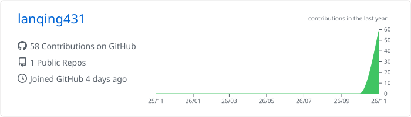
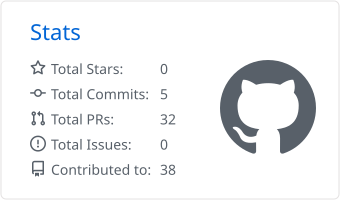
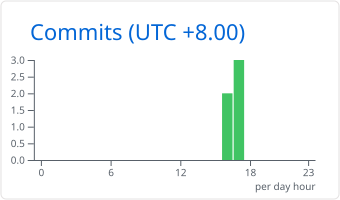

<!-- 顶部：缓慢流动的波浪横幅 -->
<picture>
  <source media="(prefers-color-scheme: dark)" srcset="https://capsule-render.vercel.app/api?type=waving&color=0:111B30,100:24385A&height=200&section=header&text=lanqing431&fontSize=52&fontColor=DCE8FC&fontAlignY=36&desc=Agent%20Developer&descSize=18&descAlignY=58&animation=fadeIn">
  <source media="(prefers-color-scheme: light)" srcset="https://capsule-render.vercel.app/api?type=waving&color=0:A1C4FD,100:C2E9FB&height=200&section=header&text=lanqing431&fontSize=52&fontColor=172B4D&fontAlignY=36&desc=Agent%20Developer&descSize=18&descAlignY=58&animation=fadeIn">
  
</picture>

<!-- 打字机效果 -->
<p align="center">
  <picture>
  <source media="(prefers-color-scheme: dark)" srcset="https://readme-typing-svg.demolab.com?font=Noto+Sans+SC&weight=500&size=22&duration=3000&pause=1200&color=9DBCF6&center=true&vCenter=true&width=560&height=50&lines=%E4%BD%A0%E5%A5%BD%EF%BC%8C%E6%88%91%E6%98%AF%20lanqing431%20%F0%9F%91%8B;%E4%B8%80%E5%90%8D%20Agent%20%E5%BC%80%E5%8F%91%E8%80%85;%E8%AE%A9%E6%A8%A1%E5%9E%8B%E5%AD%A6%E4%BC%9A%E6%80%9D%E8%80%83%E3%80%81%E8%A7%84%E5%88%92%E4%B8%8E%E8%A1%8C%E5%8A%A8;Think%20%E2%86%92%20Plan%20%E2%86%92%20Act%20%E2%86%92%20Reflect">
  <source media="(prefers-color-scheme: light)" srcset="https://readme-typing-svg.demolab.com?font=Noto+Sans+SC&weight=500&size=22&duration=3000&pause=1200&color=305992&center=true&vCenter=true&width=560&height=50&lines=%E4%BD%A0%E5%A5%BD%EF%BC%8C%E6%88%91%E6%98%AF%20lanqing431%20%F0%9F%91%8B;%E4%B8%80%E5%90%8D%20Agent%20%E5%BC%80%E5%8F%91%E8%80%85;%E8%AE%A9%E6%A8%A1%E5%9E%8B%E5%AD%A6%E4%BC%9A%E6%80%9D%E8%80%83%E3%80%81%E8%A7%84%E5%88%92%E4%B8%8E%E8%A1%8C%E5%8A%A8;Think%20%E2%86%92%20Plan%20%E2%86%92%20Act%20%E2%86%92%20Reflect">
  
</picture>
</p>

<p align="center">
  
</p>

---

### 🧭 关于我

```python
class Lanqing431(Agent):
    role    = "Agent 开发者"
    goal    = "构建能真正把事情做完的智能体"
    loop    = ["感知", "思考", "规划", "行动", "反思"]
    belief  = "好的 Agent 不是更会说话，而是更会做事"

    def run(self):
        while curious:
            self.build()    # 写代码
            self.observe()  # 看结果
            self.reflect()  # 再改进
```

- 🤖 专注于 **AI Agent** 的设计与开发
- 🧩 关心工具调用、任务规划、记忆与多智能体协作
- 🔁 相信迭代：先跑起来，再变得更好

---

### 📊 我的 GitHub

<p align="center">
  <picture>
    <source media="(prefers-color-scheme: dark)" srcset="./profile-summary-card-output/github_dark/0-profile-details.svg" />
    
  </picture>
</p>

<p align="center">
  <picture>
    <source media="(prefers-color-scheme: dark)" srcset="./profile-summary-card-output/github_dark/3-stats.svg" />
    
  </picture>
  <picture>
    <source media="(prefers-color-scheme: dark)" srcset="./profile-summary-card-output/github_dark/4-productive-time.svg" />
    
  </picture>
</p>

---

### 🐍 贡献足迹

<p align="center">
  <picture>
    <source media="(prefers-color-scheme: dark)" srcset="https://raw.githubusercontent.com/lanqing431/lanqing431/output/github-snake-dark.svg" />
    
  </picture>
</p>

<p align="center"><i>「 让每一次调用，都离目标更近一步 」</i></p>

<!-- 底部波浪 -->
<picture>
  <source media="(prefers-color-scheme: dark)" srcset="https://capsule-render.vercel.app/api?type=waving&color=0:24385A,100:111B30&height=120&section=footer">
  <source media="(prefers-color-scheme: light)" srcset="https://capsule-render.vercel.app/api?type=waving&color=0:C2E9FB,100:A1C4FD&height=120&section=footer">
  
</picture>
