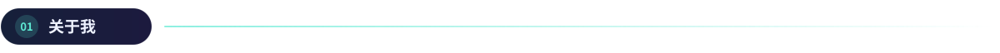
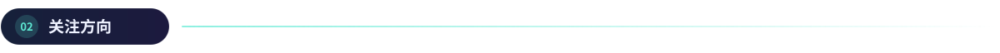
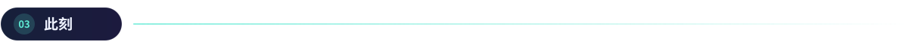
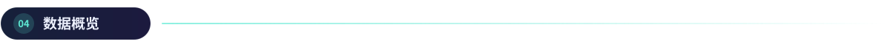

<!-- 主页图片均由 assets/generate.py 生成；数据卡片与贡献蛇由 GitHub Action 每天自动更新 -->

  <picture>
    <source media="(prefers-color-scheme: dark)" srcset="https://raw.githubusercontent.com/lanqing431/lanqing431/main/assets/generated/snake-dark.svg" />
    
  </picture>

