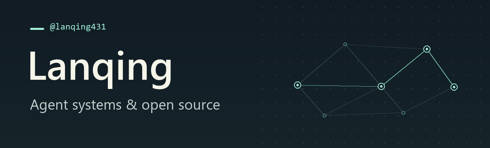

  

我在学习和实践 **AI Agent 工程**，关注工具调用、上下文与记忆，以及任务失败后怎么恢复。我也给开源项目修补具体问题，从复现行为、追源码，到验证修复。

## 已合并的开源贡献

| 项目 | 修复内容 |
| --- | --- |
| **WeKnora** | 修复 EPUB 文件走 ZIP 回退路径时，混合大小写的章节文件后缀被漏识别的问题。[查看 PR #5928](https://github.com/Tencent/WeKnora/pull/5928) |
| **ffandown** | 修复 RTMP 下载错误收到 RTSP 专用输入参数的问题。[查看 PR #101](https://github.com/helson-lin/ffandown/pull/101) |

## 正在研究

- **Agent 执行链路** · 一条用户请求如何经过模型、工具和结果回传。
- **上下文与记忆** · 哪些状态需要持久化，下一次会话如何把它们读回来。
- **失败与恢复** · 工具超时或任务中断后，如何重试和接续。

[查看公开的 Pull Requests](https://github.com/pulls?q=is%3Apr+is%3Apublic+author%3Alanqing431)
